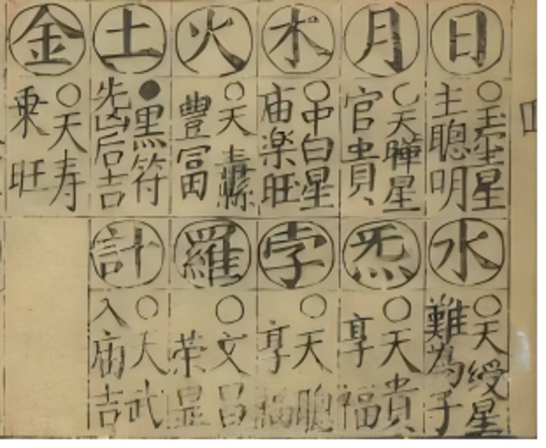
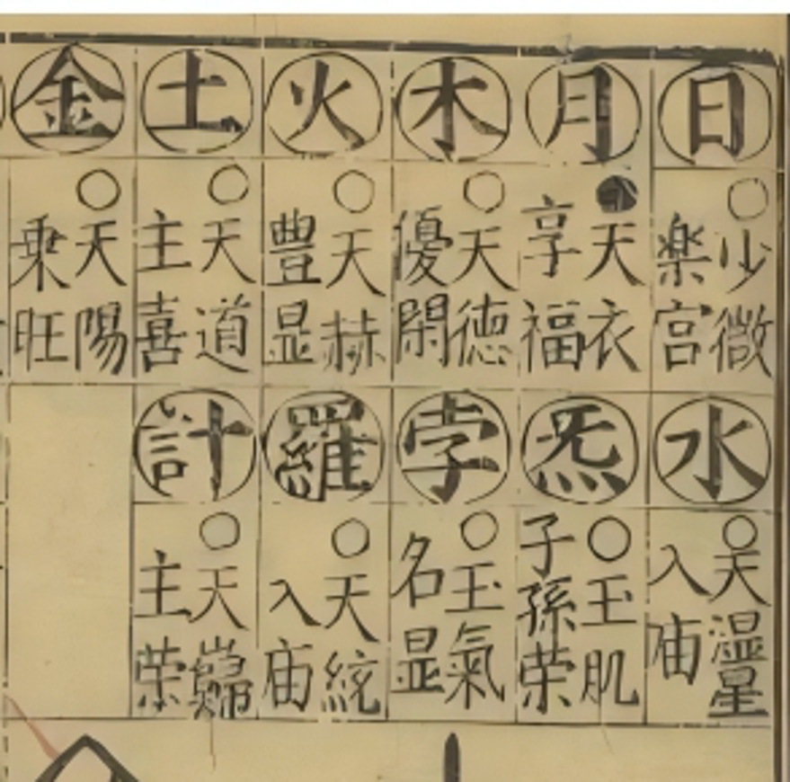
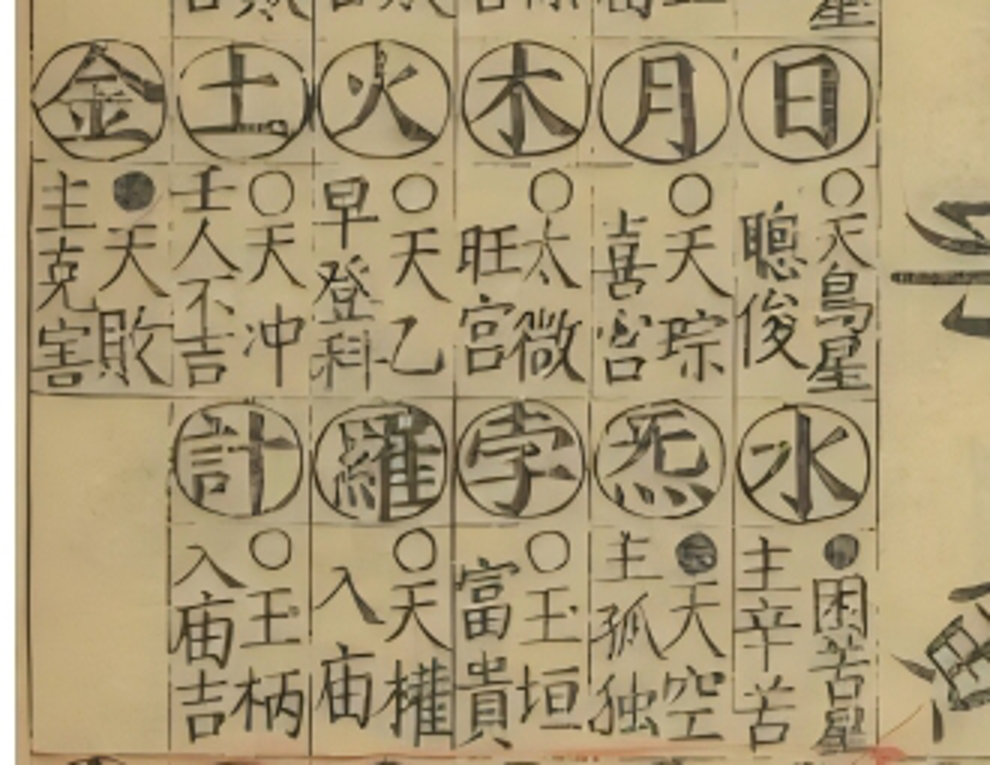
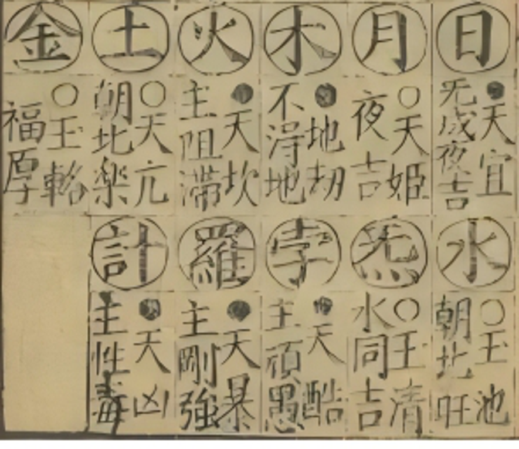
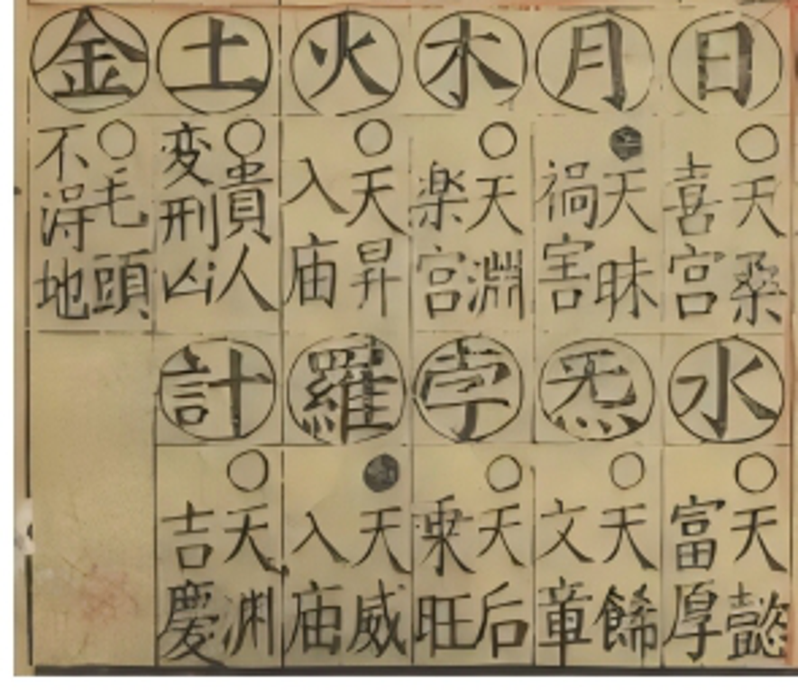
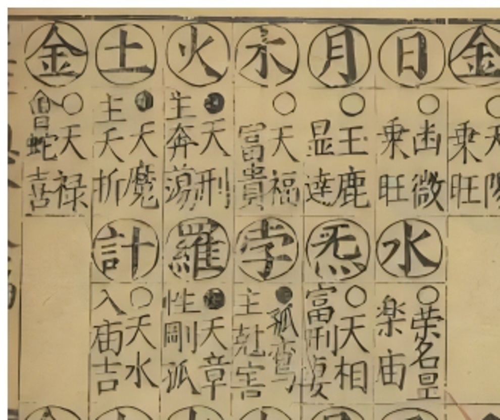
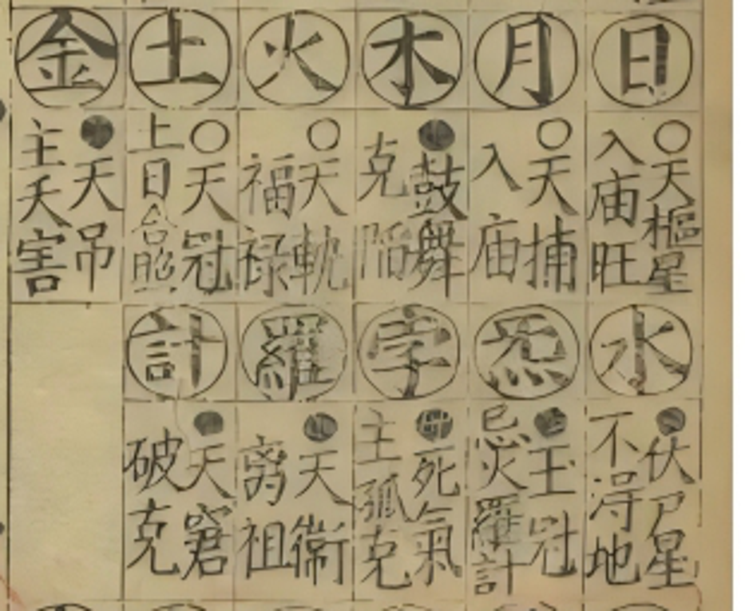
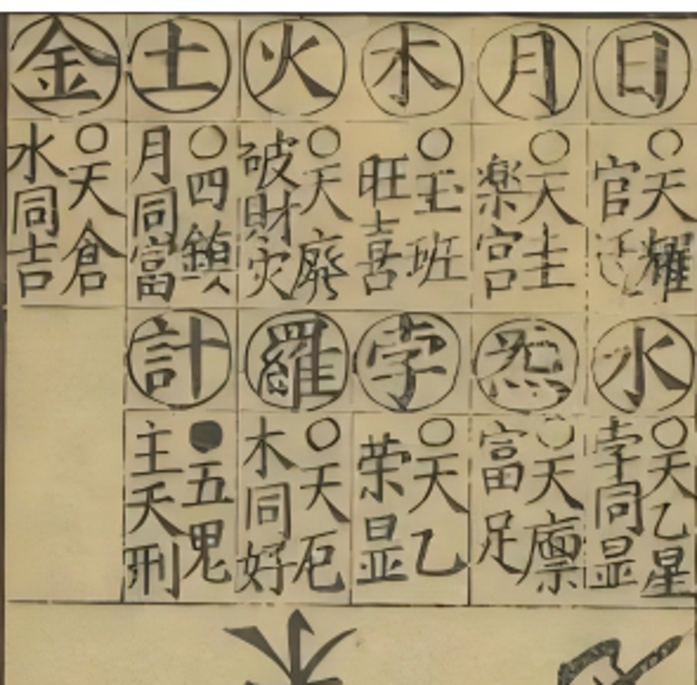
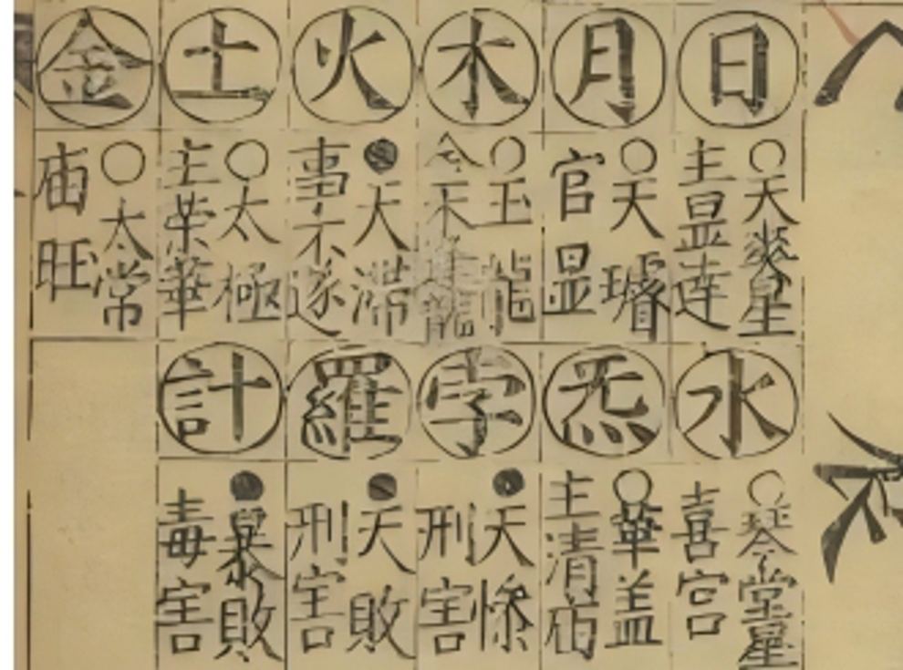
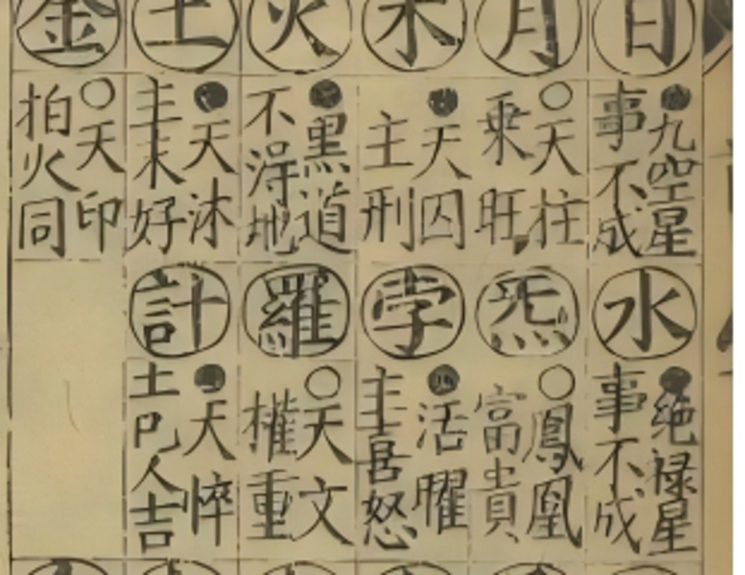

# 命海第16頁剩餘字列原圖對照

目前12組文字註、19組變曜名待核，共31格。既有原字保留；本檔不給猜字答案，不把模型推算當原圖。

每格上方圈內字是原圖星名，下方右列為曜名、左列為文字註；兩者的字形均以原圖逐格確認，不依其他宮位補值。○●涵義未作判讀。

## 亥宮

|原圖星名|尚未確認的欄|
|---|---|
|水|可確認文字註|
|羅|可確認文字註|

## 午宮

|原圖星名|尚未確認的欄|
|---|---|
|孛|可確認變曜名字|
|木|可確認文字註|
|炁|可確認變曜名字|
|計|可確認變曜名字|

## 卯宮

|原圖星名|尚未確認的欄|
|---|---|
|日|可確認變曜名字|
|計|可確認變曜名字|

## 子宮

|原圖星名|尚未確認的欄|
|---|---|
|水|可確認變曜名字|
|炁|可確認變曜名字|
|金|可確認變曜名字|

## 寅宮

|原圖星名|尚未確認的欄|
|---|---|
|水|可確認變曜名字|
|計|可確認變曜名字|

## 巳宮

|原圖星名|尚未確認的欄|
|---|---|
|孛|可確認文字註|
|日|可確認變曜名字|
|水|可確認變曜名字|
|炁|可確認文字註|
|金|可確認文字註|

## 戌宮

|原圖星名|尚未確認的欄|
|---|---|
|土|可確認文字註|
|火|可確認變曜名字|
|炁|可確認變曜名字|
|羅|可確認文字註|

## 未宮

|原圖星名|尚未確認的欄|
|---|---|
|日|可確認文字註|
|木|可確認變曜名字|
|水|可確認文字註|

## 辰宮

|原圖星名|尚未確認的欄|
|---|---|
|日|可確認變曜名字|
|月|可確認變曜名字|
|木|可確認文字註|
|水|可確認變曜名字|
|火|可確認變曜名字|

## 酉宮

|原圖星名|尚未確認的欄|
|---|---|
|計|可確認文字註|

以上為原頁局部，未補畫文字；文字層或放大無法恢復原圖缺失筆畫。
狀態以[逐格核對](../檢查/命海16逐格核對.json)為準。

## 後續處理（2026-11-18）
上方31格為提供原圖時的快照。使用者後續補缺27欄已追加；目前尚1組文字註、3組曜名未提供，另6處異讀待修字授權。最新清單以命海16逐格核對.json為準，不將本快照當作目前待核數。
