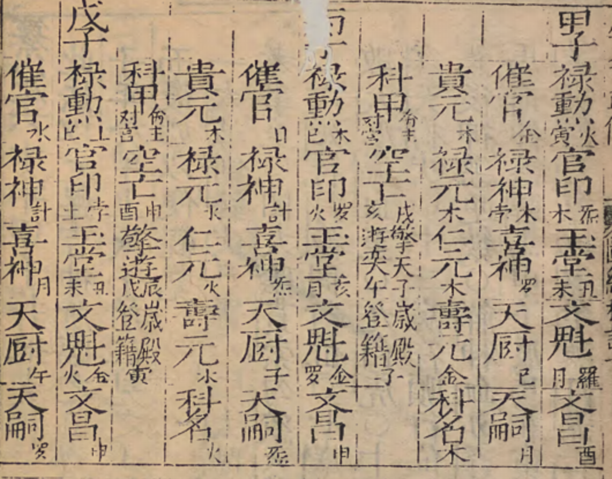
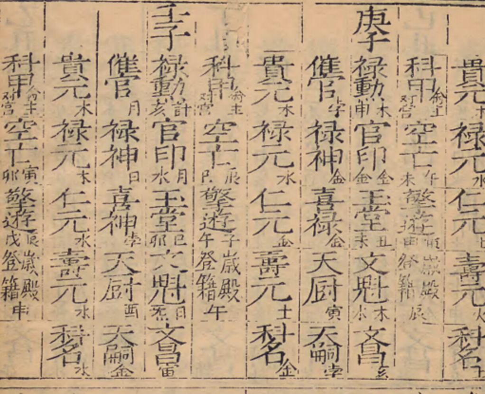
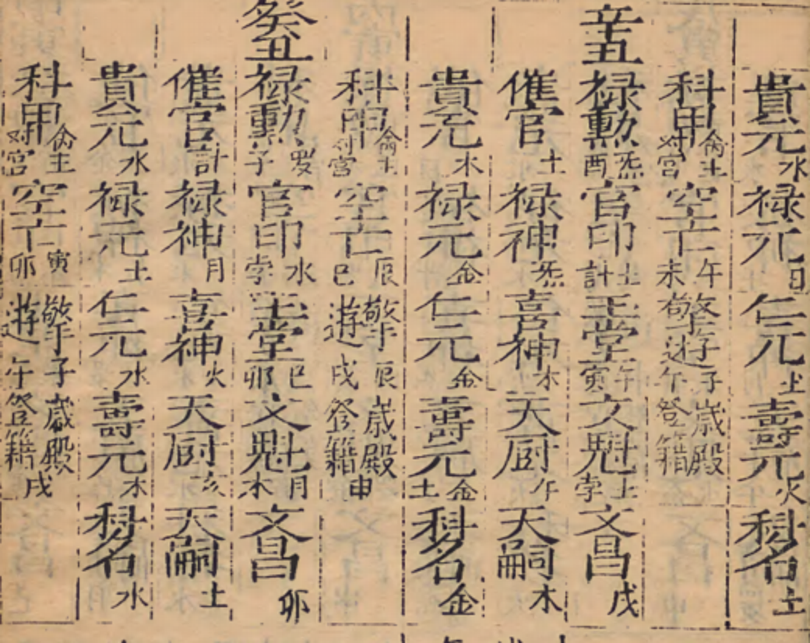
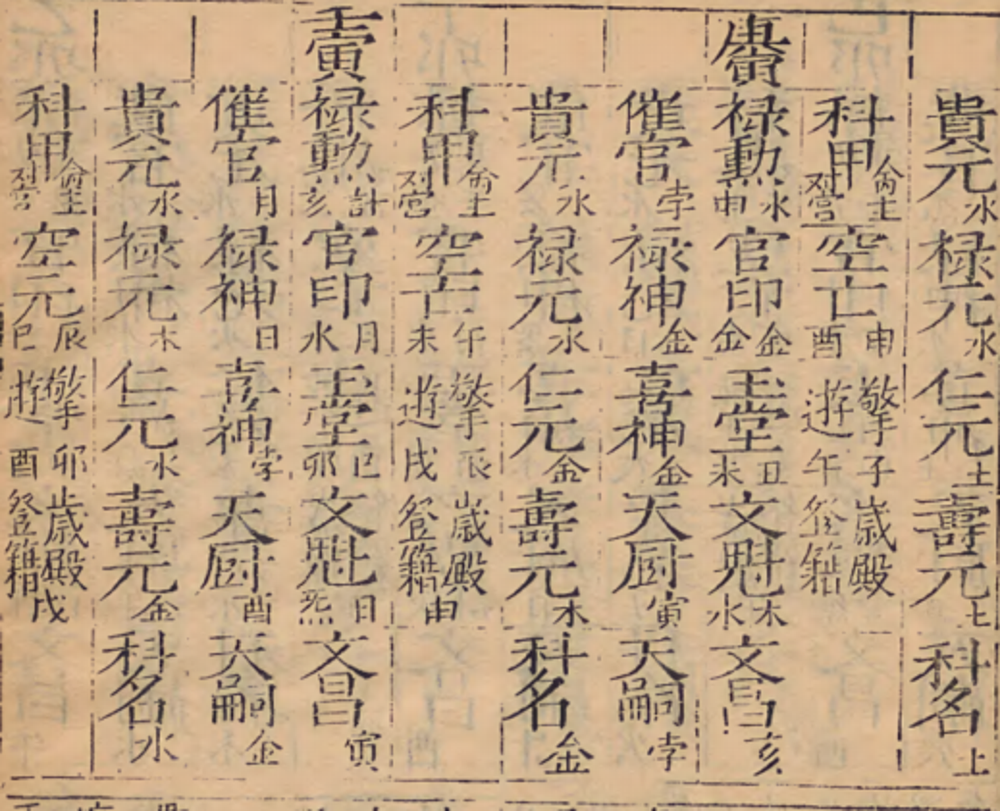
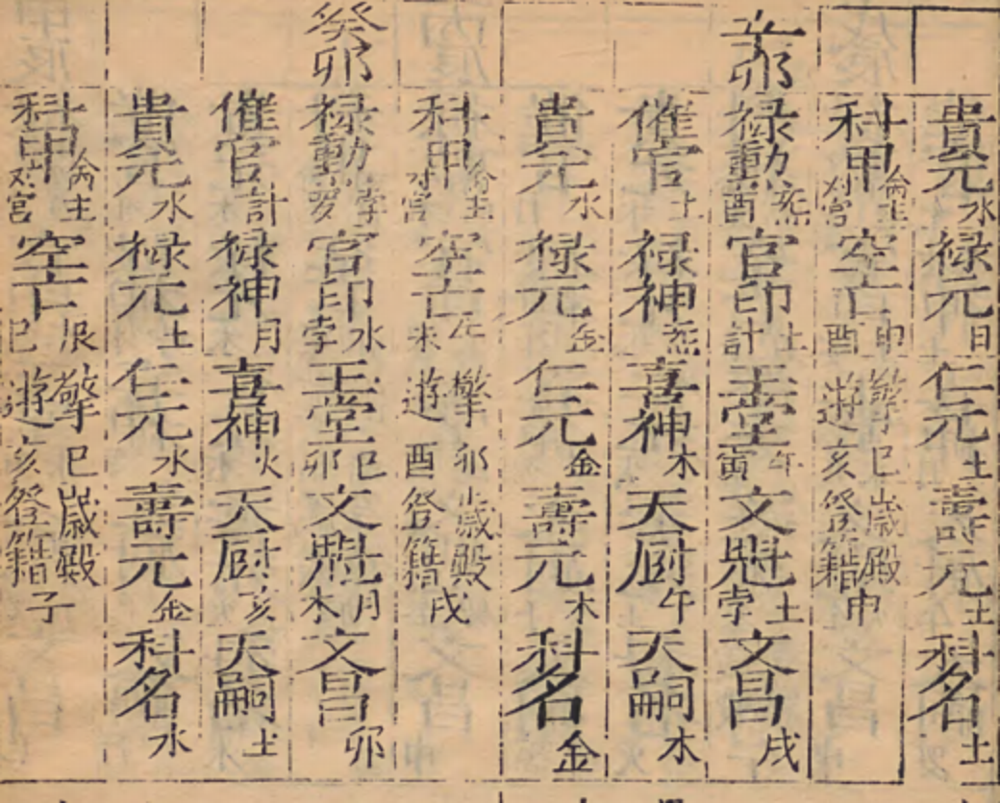

# 八筆修字提案（未套用）

這是原圖字形與既有卡片的差異提案，不是已完成修正。原卡保留不動。

## 必須分開看的兩件事
- 原圖聯列下方字形與8張既有歲殿卡的字值不同，候選差異如下。
- 同一旁字能否獨立歸屬歲殿與登籍，69張全數仍待核；即使同意修這8字，也不能宣告卡片已可用。

## 擬改字清單

|卡片|PDF頁碼|現存字|圖中聯列下方字形（擬改字）|
|---|---|---|---|
|歲殿圖列·壬子（星學綱目圖說下）.md|74|辰|申|
|歲殿圖列·壬寅（星學綱目圖說下）.md|78|卯|戌|
|歲殿圖列·庚寅（星學綱目圖說下）.md|78|子|申|
|歲殿圖列·戊子（星學綱目圖說下）.md|73|辰|寅|
|歲殿圖列·癸丑（星學綱目圖說下）.md|76|子|戌|
|歲殿圖列·癸卯（星學綱目圖說下）.md|80|巳|子|
|歲殿圖列·辛丑（星學綱目圖說下）.md|76|辰|申|
|歲殿圖列·辛卯（星學綱目圖說下）.md|80|巳|戌|

## 可裁決的處理方式
1. 同意只套用上述8個字的差異；不改題名、不改其他內容、不刪卡，69張歸屬仍待核。
2. 暫不改字，保留8筆差異及69張歸屬待核，繼續其他可讀內容。

依目前「不改既有原文」規定，未取得同意前不套用任何差異。
提案差異檔：[歲殿8筆修字提案.patch](歲殿8筆修字提案.patch)。
依據：[69卡字形續核結果](../檢查/綱目歲殿登籍69卡字形續核結果.json)。
這是人工圖像核對與腳本差異比對，不是獨立代理實跑或使用者驗收。

## 原圖對照（未補畫文字）

以下為原PDF內嵌頁圖；放大圖只裁切上表並等比例放大。字形差異不代表旁字歸屬已確認，請先看原圖，不要只依候選表同意修字。

### PDF第73頁

戊子在左側；候選比較辰／寅。

[查看未裁切原頁圖](原圖/綱目-73-原頁圖.png)

### PDF第74頁

壬子在左側；候選比較辰／申。

[查看未裁切原頁圖](原圖/綱目-74-原頁圖.png)

### PDF第76頁

辛丑在中間、癸丑在左；候選比較辰／申、子／戌。

[查看未裁切原頁圖](原圖/綱目-76-原頁圖.png)

### PDF第78頁

庚寅在中間、壬寅在左；候選比較子／申、卯／戌。

[查看未裁切原頁圖](原圖/綱目-78-原頁圖.png)

### PDF第80頁

辛卯在中間、癸卯在左；候選比較巳／戌、巳／子。

[查看未裁切原頁圖](原圖/綱目-80-原頁圖.png)
