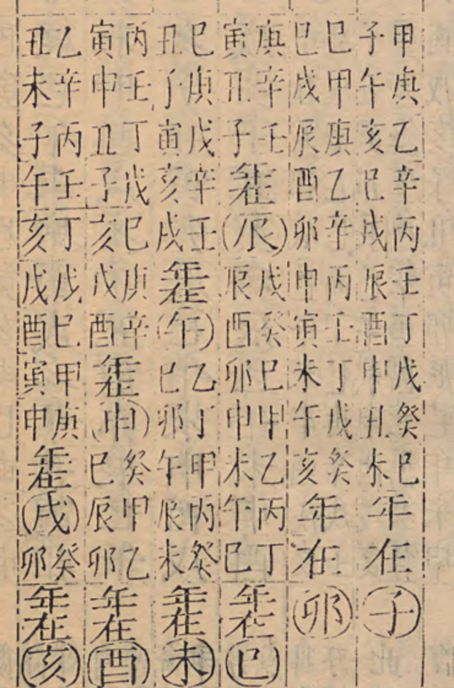

# 綱目第101頁圈字與列序待核

來源：《星學綱目正傳》PDF實際第101頁；局部原圖只裁切放大，未補字。

右起前兩組年在子、年在卯字列已分段存卡；其他四組尚未完成。
圖中辰、午、申、戌圈字穿插在上下字列之間，無法可靠確定其分支、列序或歸屬；不可將圈字忽略後硬拼兩列，也不可按干支規律補值。
PaddleOCR分成六個區域只是裁切方法，不是原書六個邏輯分組已驗證。
目前需要人工核對四個圈字前後哪些字連成同一項；未確認前維持待核，不新增這四組的規則卡，不改既有卡。
