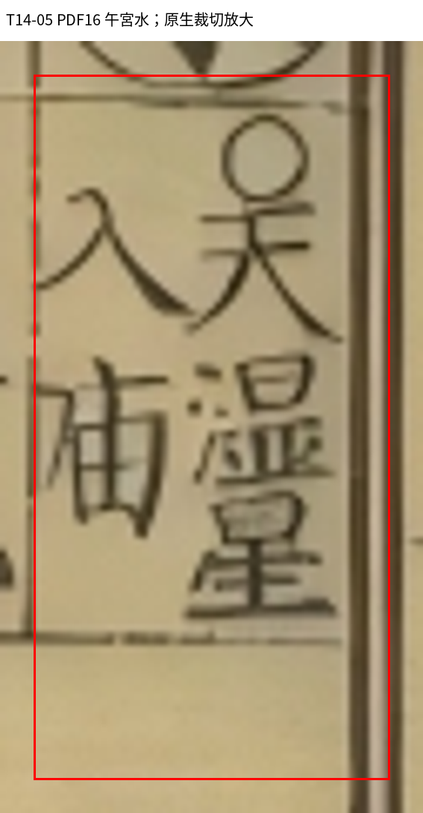
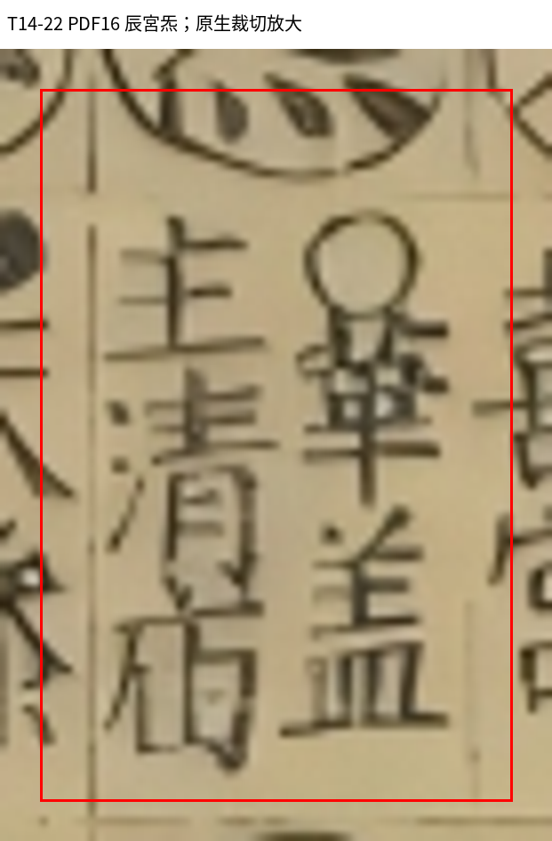
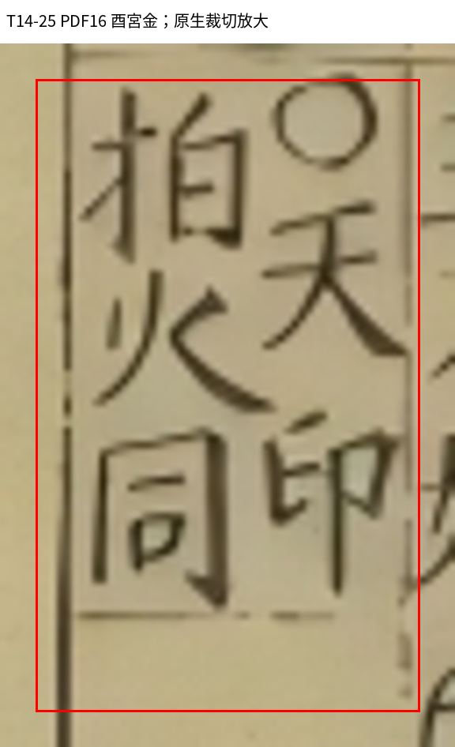

# T14授權修訂前逐格清單

日期：2026-11-20。先讀現卡與授權值、產生本清單及完整舊新稿，再執行限定替換。

|格／卡名|舊值|授權新值|原PDF頁|紅框原圖|
|---|---|---|---|---|
|T14-01 亥宮日圖列（星平總會命海）.md|長生星|玉璽星|16|[原圖](../待裁決/原圖/命海T14/T14-01.png)|
|T14-02 亥宮月圖列（星平總會命海）.md|天臂星|天暉星|16|[原圖](../待裁決/原圖/命海T14/T14-02.png)|
|T14-04 亥宮孛圖列（星平總會命海）.md|天旺|天聰|16|[原圖](../待裁決/原圖/命海T14/T14-04.png)|
|T14-05 午宮水圖列（星平總會命海）.md|天溫星|天濕星|16|[原圖](../待裁決/原圖/命海T14/T14-05.png)|
|T14-06 卯宮月圖列（星平總會命海）.md|天宗|天琮|16|[原圖](../待裁決/原圖/命海T14/T14-06.png)|
|T14-06 卯宮月圖列（星平總會命海）.md|喜宮|入廟|16|[原圖](../待裁決/原圖/命海T14/T14-06.png)|
|T14-07 卯宮水圖列（星平總會命海）.md|閑宮星|困苦星|16|[原圖](../待裁決/原圖/命海T14/T14-07.png)|
|T14-08/09 卯宮炁圖列（星平總會命海）.md|天垣|天空|16|[原圖](../待裁決/原圖/命海T14/T14-08.png)|
|T14-08/09 卯宮炁圖列（星平總會命海）.md|富貴|主孤獨|16|[原圖](../待裁決/原圖/命海T14/T14-08.png)|
|T14-10/11 卯宮孛圖列（星平總會命海）.md|天空|玉垣|16|[原圖](../待裁決/原圖/命海T14/T14-10.png)|
|T14-10/11 卯宮孛圖列（星平總會命海）.md|主孤獨|富貴|16|[原圖](../待裁決/原圖/命海T14/T14-10.png)|
|T14-12 子宮月圖列（星平總會命海）.md|天娼|天姬|16|[原圖](../待裁決/原圖/命海T14/T14-12.png)|
|T14-14 子宮火圖列（星平總會命海）.md|天災|天坎|16|[原圖](../待裁決/原圖/命海T14/T14-14.png)|
|T14-16 子宮土圖列（星平總會命海）.md|天元|天亢|16|[原圖](../待裁決/原圖/命海T14/T14-16.png)|
|T14-17 子宮孛圖列（星平總會命海）.md|天醜|天酷|16|[原圖](../待裁決/原圖/命海T14/T14-17.png)|
|T14-22 辰宮炁圖列（星平總會命海）.md|主清高|主清廟|16|[原圖](../待裁決/原圖/命海T14/T14-22.png)|
|T14-23 辰宮孛圖列（星平總會命海）.md|天祿|天慘|16|[原圖](../待裁決/原圖/命海T14/T14-23.png)|
|T14-25 酉宮金圖列（星平總會命海）.md|相火同|拍火同|16|[原圖](../待裁決/原圖/命海T14/T14-25.png)|
|T14-26 酉宮水圖列（星平總會命海）.md|絕根星|絕祿星|16|[原圖](../待裁決/原圖/命海T14/T14-26.png)|

亥宮孛旁註現為「享福」，與授權相同：保留，不補字、不改旁註。
卯宮月現旁註「喜宮」與授權「入廟」不同，已列為明確授權替換，並非自行補註。

## 與舊候選不同的三筆

T14-05：現天溫星、舊候選天漫星、使用者天濕星。T14-22：現主清高、舊候選主清貴、使用者主清廟。T14-25：現相火同、舊候選柏火同、使用者拍火同。只按本輪授權，不把三者視為同字。

