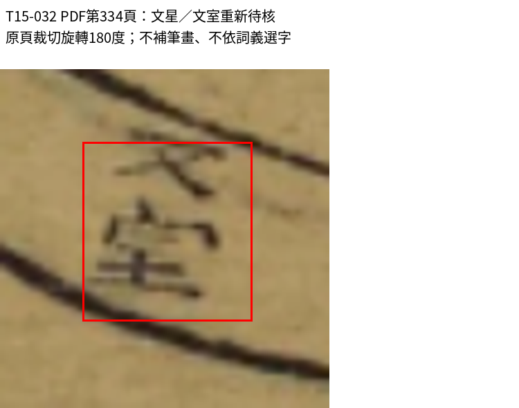

# T15-032文星／文室再核

使用者新回覆：「T15-032可能是文室」。這是候選，未視為最終採字授權。

## 現況與原圖

- 卡片：[命例·狀元沈懋學命](../../qi-zheng-si-yu/knowledge/命例·狀元沈懋學命（總會命海末卷兼載子平）.md)。
- 來源：《星平總會命海》PDF實際第334頁；目前卡片收文星，前次判讀不再當作無疑的原圖定字。
- 放大後，上方較像宀形覆蓋線、下方似至，較支持室；筆畫連接仍有模糊，不因文星較常見而選文星。
- 只旋轉、縮放既有原頁裁片，不畫補筆畫；原刻最後採字仍待使用者確認。

[原有裁片](../待裁決/原圖/T15-032.png)與[前次四方向圖](../待裁決/原圖/完整裁決方向/T15-032-四方向.png)保留，不覆寫。

## 處理

本次不改任何卡片。T15-032重新列入待核；選項文室／文星／其他字／看不清。前次完整裁決報告的四處待核是當時快照，現在另加此項為五處。
