# 命海第16頁T14本輪逐筆複核

## 目錄

- [範圍](#範圍)
- [27筆一題一圖](#27筆一題一圖)
- [三處淂字共同裁決](#三處淂字共同裁決)
- [需要使用者決定](#需要使用者決定)

## 範圍

27筆各別提報，不整批接受候選，不改卡。原刻異體保留；只因繁簡或異體不同者可以退回不裁。
原PDF第16頁內嵌圖原生1186×1005像素。以下直接從該原生圖裁切；放大只供觀看，不描補筆畫。來源類型皆人工校讀。

## 27筆一題一圖

### T14-01

卡片：亥宮日圖列（星平總會命海）.md；第16頁。現讀：長生星；候選：玉璽星。
判斷：待看原圖／無法判斷。依據：候選各別審，不由其他工具結論或同詞重出定稿。
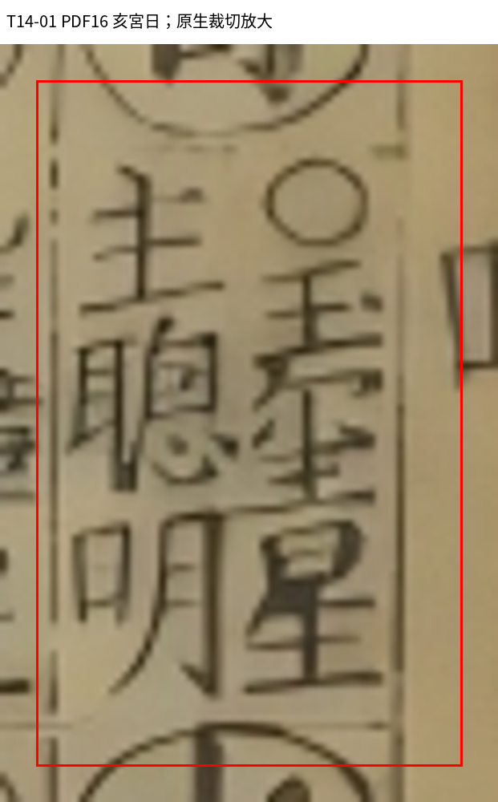

請看紅框內的字，是「長生星」還是「玉璽星」？

### T14-02

卡片：亥宮月圖列（星平總會命海）.md；第16頁。現讀：天臂星；候選：天暉星。
判斷：待看原圖／無法判斷。依據：候選各別審，不由其他工具結論或同詞重出定稿。
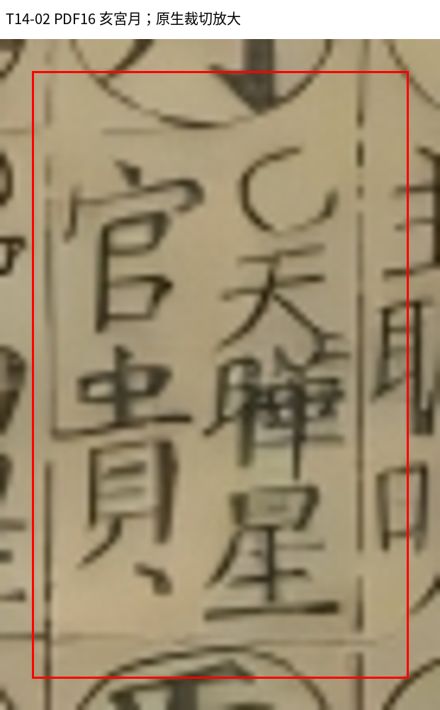

請看紅框內的字，是「天臂星」還是「天暉星」？

### T14-03

卡片：亥宮火圖列（星平總會命海）.md；第16頁。現讀：天縻；候選：天纛。
判斷：待看原圖／無法判斷。依據：上部有中豎與多橫，下部密集複合；較支持纛而非縻的广覆林結構，但細筆模糊，仍只列候選。
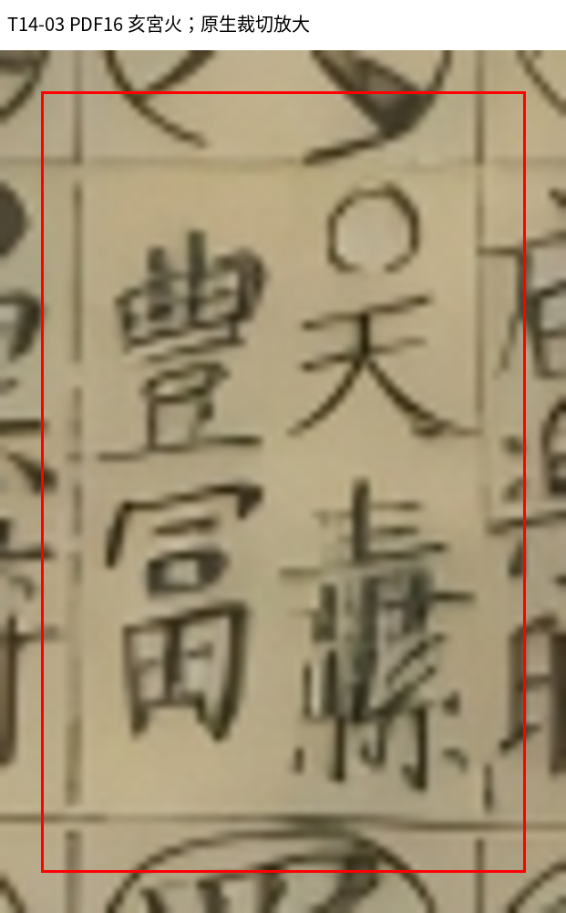

請看紅框內的字，是「天縻」還是「天纛」？

### T14-04

卡片：亥宮孛圖列（星平總會命海）.md；第16頁。現讀：天旺；候選：天聰。
判斷：待看原圖／無法判斷。依據：候選各別審，不由其他工具結論或同詞重出定稿。
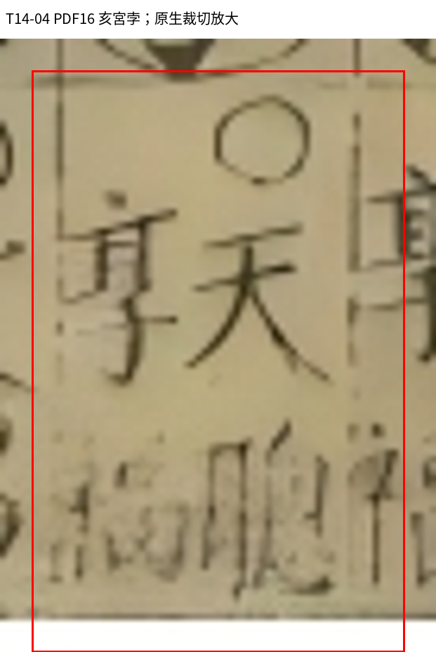

請看紅框內的字，是「天旺」還是「天聰」？

### T14-05

卡片：午宮水圖列（星平總會命海）.md；第16頁。現讀：天溫星；候選：天漫星。
判斷：待看原圖／無法判斷。依據：候選各別審，不由其他工具結論或同詞重出定稿。
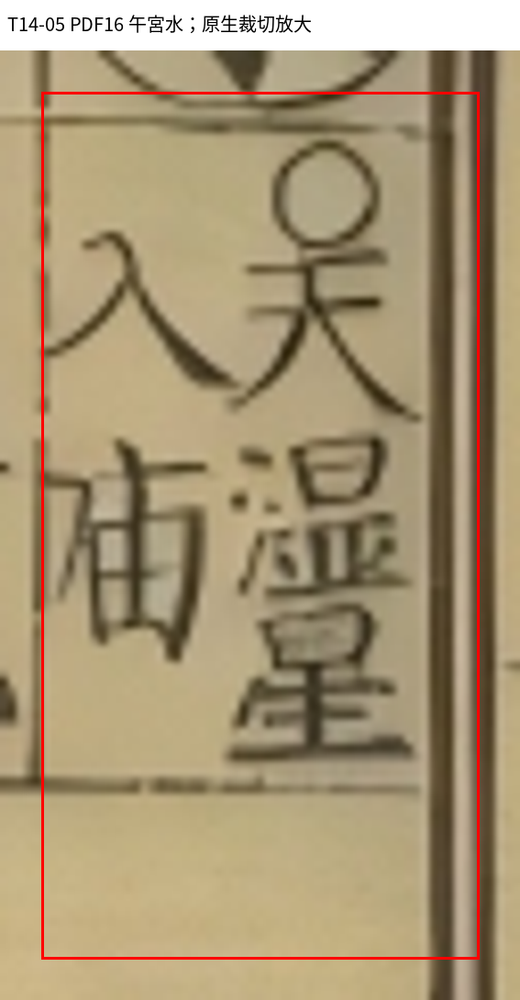

請看紅框內的字，是「天溫星」還是「天漫星」？

### T14-06

卡片：卯宮月圖列（星平總會命海）.md；第16頁。現讀：天宗；候選：天琮。
判斷：待看原圖／無法判斷。依據：候選各別審，不由其他工具結論或同詞重出定稿。
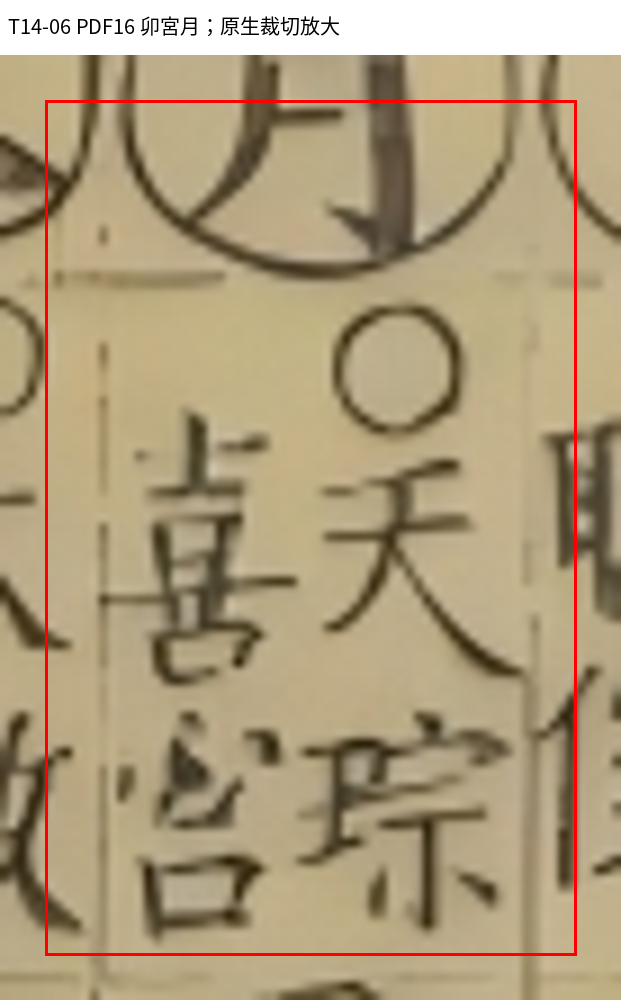

請看紅框內的字，是「天宗」還是「天琮」？

### T14-07

卡片：卯宮水圖列（星平總會命海）.md；第16頁。現讀：閑宮星；候選：困苦星。
判斷：待看原圖／無法判斷。依據：候選各別審，不由其他工具結論或同詞重出定稿。
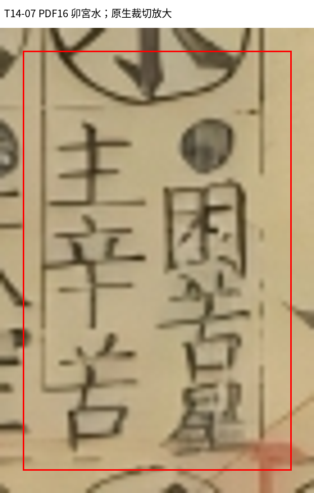

請看紅框內的字，是「閑宮星」還是「困苦星」？

### T14-08

卡片：卯宮炁圖列（星平總會命海）.md；第16頁。現讀：天垣；候選：天空。
判斷：待看原圖／無法判斷。依據：候選各別審，不由其他工具結論或同詞重出定稿。

請看紅框內的字，是「天垣」還是「天空」？

### T14-09

卡片：卯宮炁圖列（星平總會命海）.md；第16頁。現讀：富貴；候選：主孤獨。
判斷：待看原圖／無法判斷。依據：候選各別審，不由其他工具結論或同詞重出定稿。
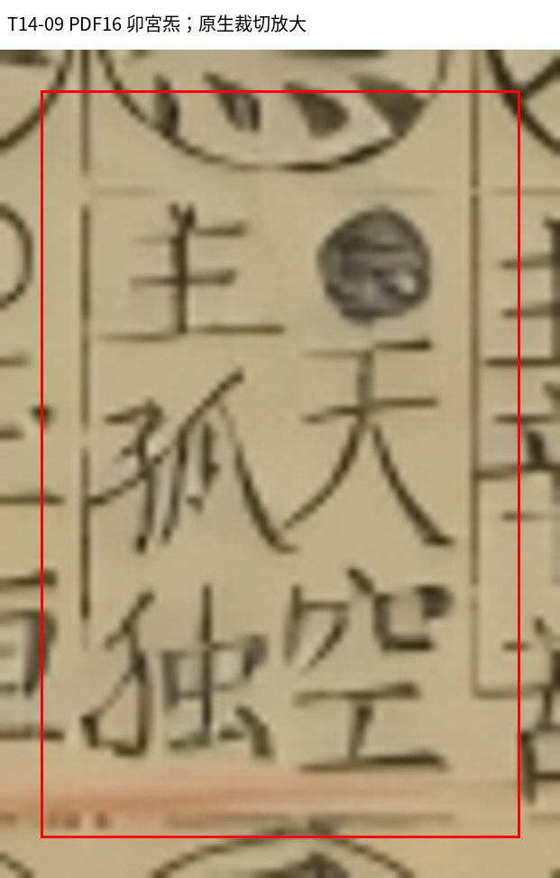

請看紅框內的字，是「富貴」還是「主孤獨」？

### T14-10

卡片：卯宮孛圖列（星平總會命海）.md；第16頁。現讀：天空；候選：玉垣。
判斷：待看原圖／無法判斷。依據：候選各別審，不由其他工具結論或同詞重出定稿。

請看紅框內的字，是「天空」還是「玉垣」？

### T14-11

卡片：卯宮孛圖列（星平總會命海）.md；第16頁。現讀：主孤獨；候選：富貴。
判斷：待看原圖／無法判斷。依據：候選各別審，不由其他工具結論或同詞重出定稿。
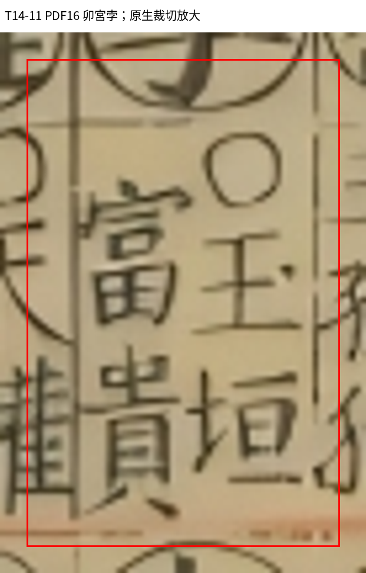

請看紅框內的字，是「主孤獨」還是「富貴」？

### T14-12

卡片：子宮月圖列（星平總會命海）.md；第16頁。現讀：天娼；候選：天姬。
判斷：待看原圖／無法判斷。依據：候選各別審，不由其他工具結論或同詞重出定稿。 只限此格，不做天娼全局替換；火躔角宿另案保持。
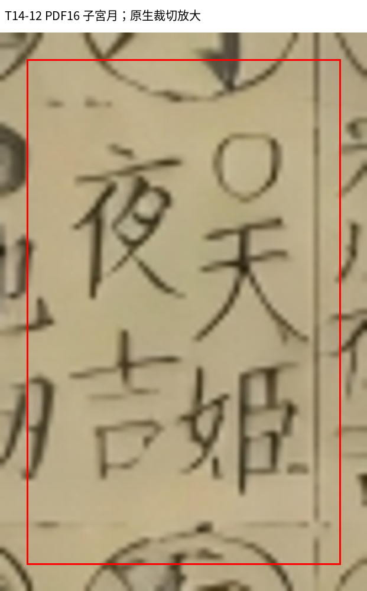

請看紅框內的字，是「天娼」還是「天姬」？

### T14-13

卡片：子宮木圖列（星平總會命海）.md；第16頁。現讀：不淨地；候選：不淂地。
判斷：待看原圖／無法判斷。依據：與另外兩格共同裁決。不得地只作通行字寫法，不覆蓋原刻淂。另看左旁與右半部件圖。
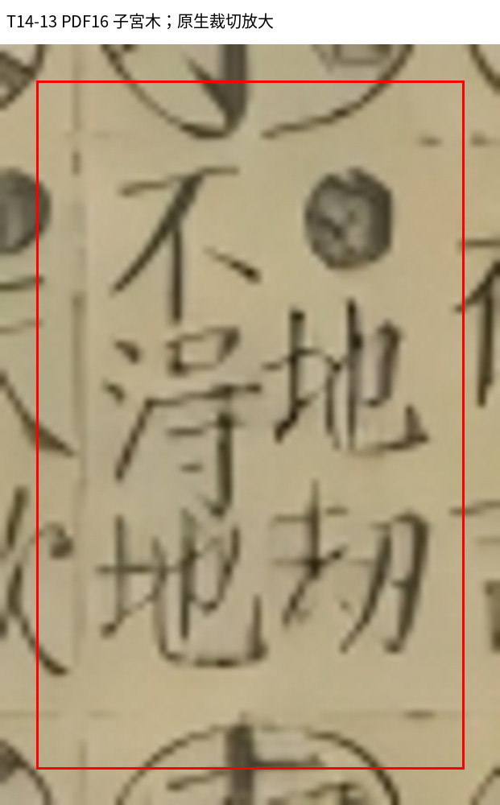

請看紅框內的字，是「不淂地」還是「不淨地」？

### T14-14

卡片：子宮火圖列（星平總會命海）.md；第16頁。現讀：天災；候選：天坎。
判斷：待看原圖／無法判斷。依據：候選各別審，不由其他工具結論或同詞重出定稿。

請看紅框內的字，是「天災」還是「天坎」？

### T14-15

卡片：子宮火圖列（星平總會命海）.md；第16頁。現讀：主阻滯；候選：主阻滞。
判斷：異體／繁簡線索，退回不裁。依據：本輪不為統一字體而換字；原刻字形需保留，候選不直接套用。
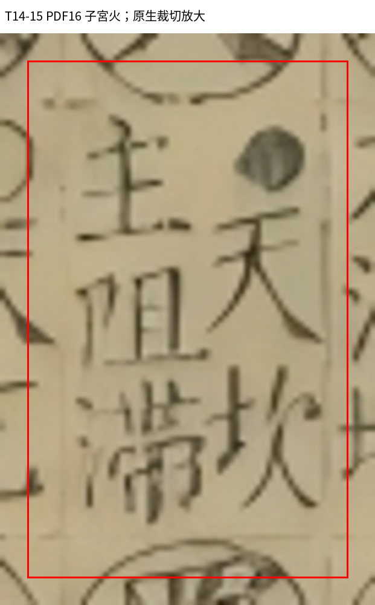

請看紅框內的字，是「主阻滯」還是「主阻滞」？

### T14-16

卡片：子宮土圖列（星平總會命海）.md；第16頁。現讀：天元；候選：天亢。
判斷：待看原圖／無法判斷。依據：候選各別審，不由其他工具結論或同詞重出定稿。
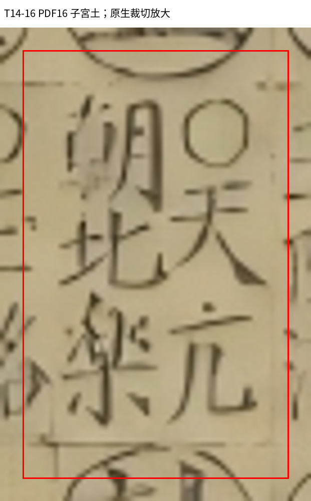

請看紅框內的字，是「天元」還是「天亢」？

### T14-17

卡片：子宮孛圖列（星平總會命海）.md；第16頁。現讀：天醜；候選：天酷。
判斷：待看原圖／無法判斷。依據：候選各別審，不由其他工具結論或同詞重出定稿。
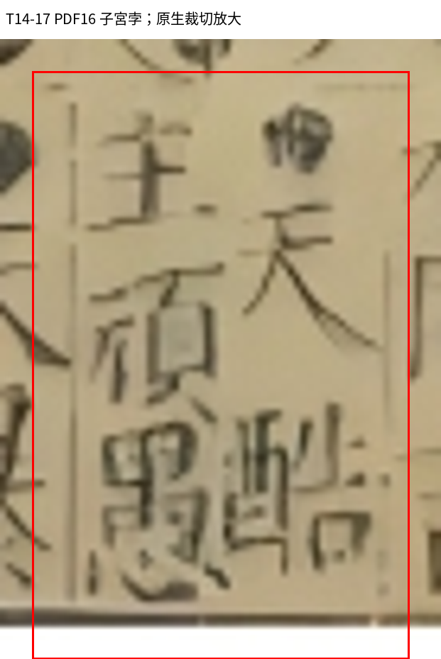

請看紅框內的字，是「天醜」還是「天酷」？

### T14-18

卡片：寅宮日圖列（星平總會命海）.md；第16頁。現讀：天柔；候選：天桑。
判斷：待看原圖／無法判斷。依據：候選各別審，不由其他工具結論或同詞重出定稿。
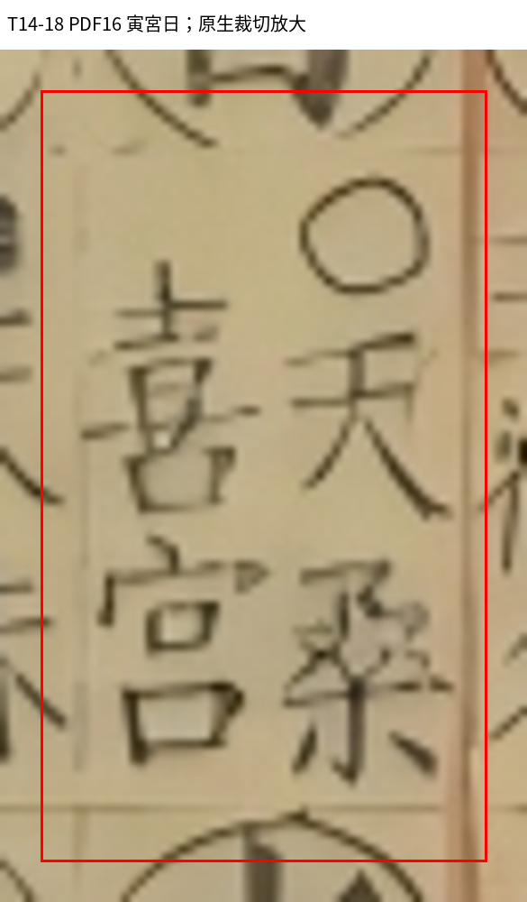

請看紅框內的字，是「天柔」還是「天桑」？

### T14-19

卡片：寅宮金圖列（星平總會命海）.md；第16頁。現讀：不淨地；候選：不淂地。
判斷：待看原圖／無法判斷。依據：與另外兩格共同裁決。不得地只作通行字寫法，不覆蓋原刻淂。另看左旁與右半部件圖。
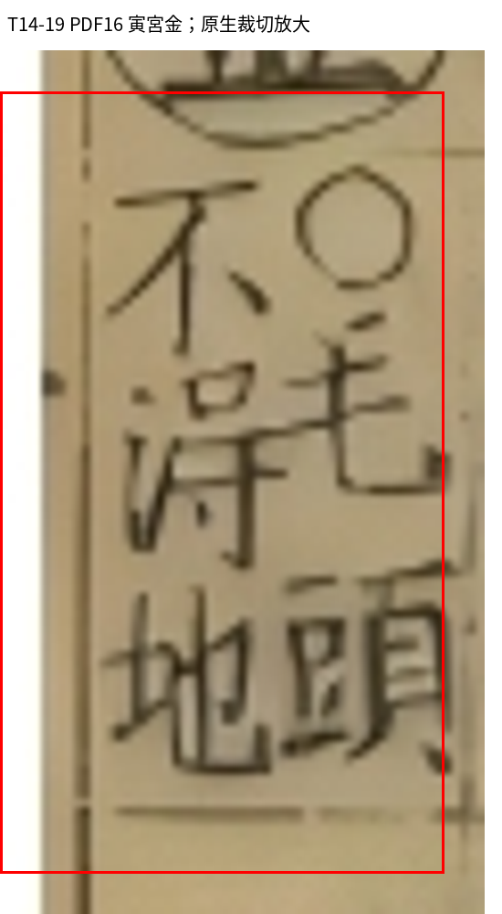

請看紅框內的字，是「不淂地」還是「不淨地」？

### T14-20

卡片：寅宮炁圖列（星平總會命海）.md；第16頁。現讀：天飾；候選：天餙。
判斷：異體／繁簡線索，退回不裁。依據：本輪不為統一字體而換字；原刻字形需保留，候選不直接套用。
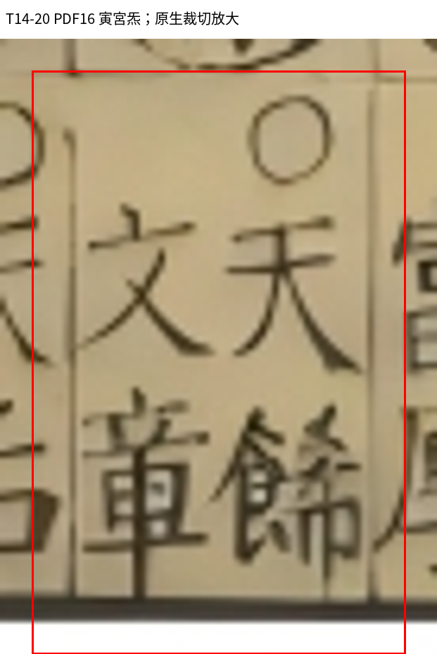

請看紅框內的字，是「天飾」還是「天餙」？

### T14-21

卡片：辰宮月圖列（星平總會命海）.md；第16頁。現讀：天睿；候選：天叡。
判斷：異體／繁簡線索，退回不裁。依據：本輪不為統一字體而換字；原刻字形需保留，候選不直接套用。
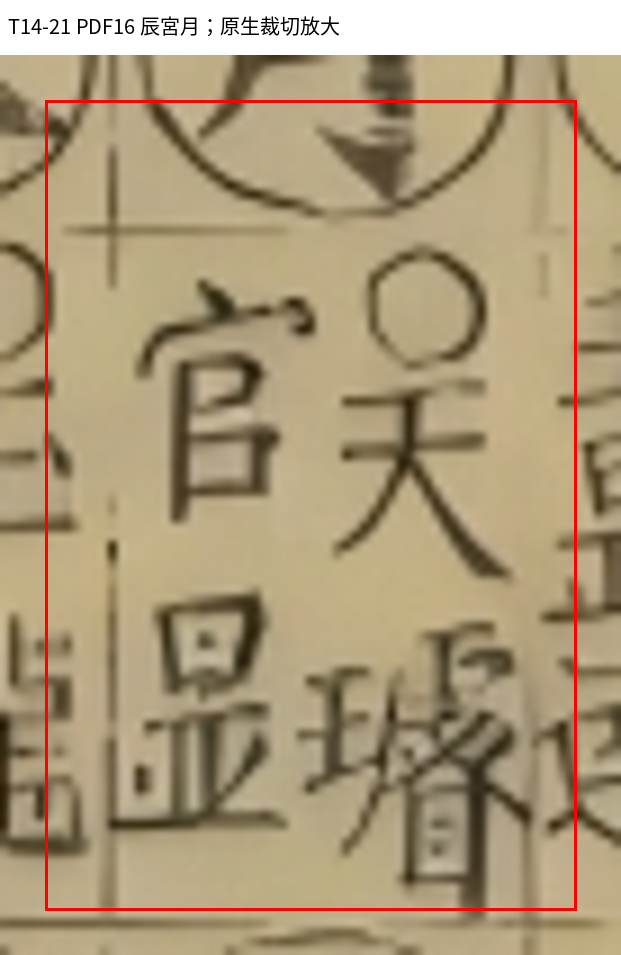

請看紅框內的字，是「天睿」還是「天叡」？

### T14-22

卡片：辰宮炁圖列（星平總會命海）.md；第16頁。現讀：主清高；候選：主清貴。
判斷：待看原圖／無法判斷。依據：候選各別審，不由其他工具結論或同詞重出定稿。
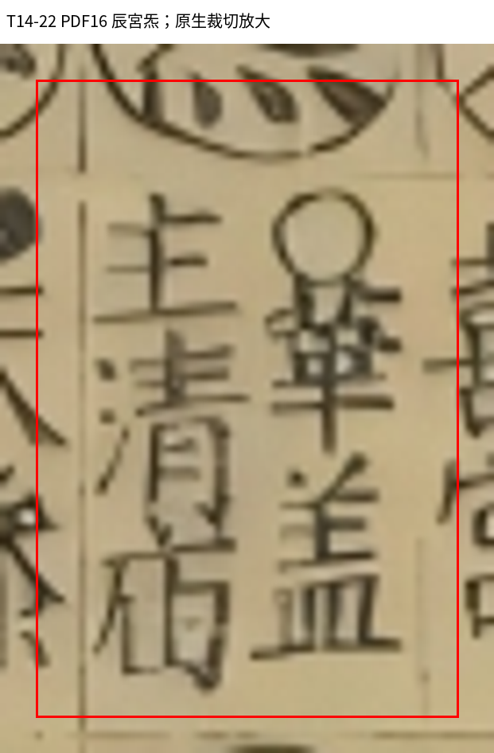

請看紅框內的字，是「主清高」還是「主清貴」？

### T14-23

卡片：辰宮孛圖列（星平總會命海）.md；第16頁。現讀：天祿；候選：天條。
判斷：待看原圖／無法判斷。依據：候選各別審，不由其他工具結論或同詞重出定稿。
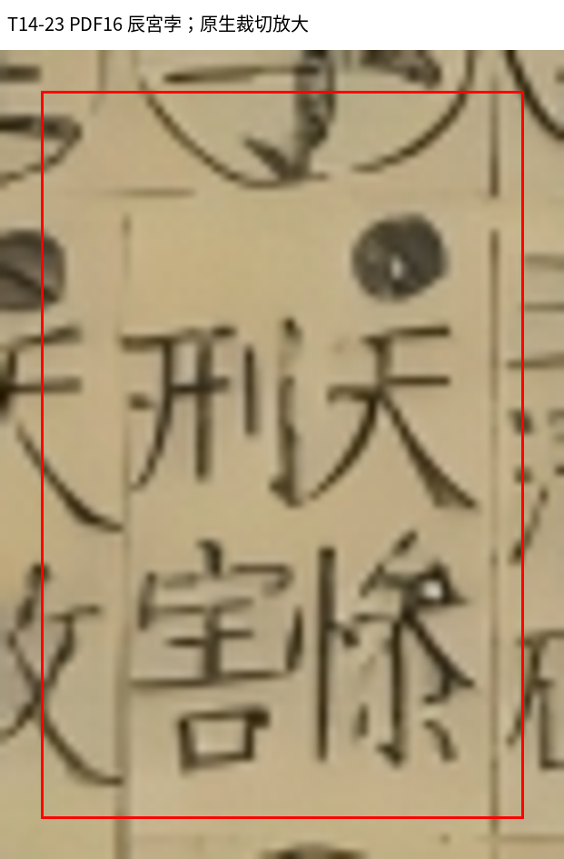

請看紅框內的字，是「天祿」還是「天條」？

### T14-24

卡片：酉宮火圖列（星平總會命海）.md；第16頁。現讀：不淨地；候選：不淂地。
判斷：待看原圖／無法判斷。依據：與另外兩格共同裁決。不得地只作通行字寫法，不覆蓋原刻淂。另看左旁與右半部件圖。
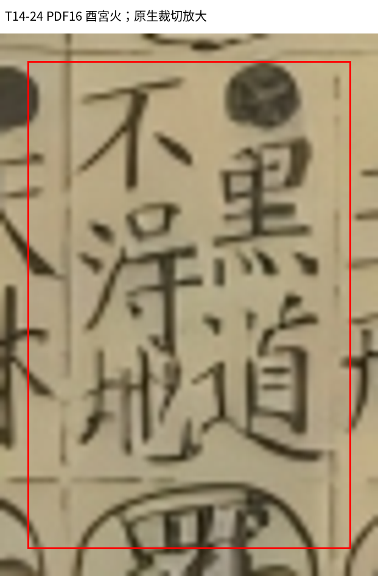

請看紅框內的字，是「不淂地」還是「不淨地」？

### T14-25

卡片：酉宮金圖列（星平總會命海）.md；第16頁。現讀：相火同；候選：柏火同。
判斷：待看原圖／無法判斷。依據：候選各別審，不由其他工具結論或同詞重出定稿。
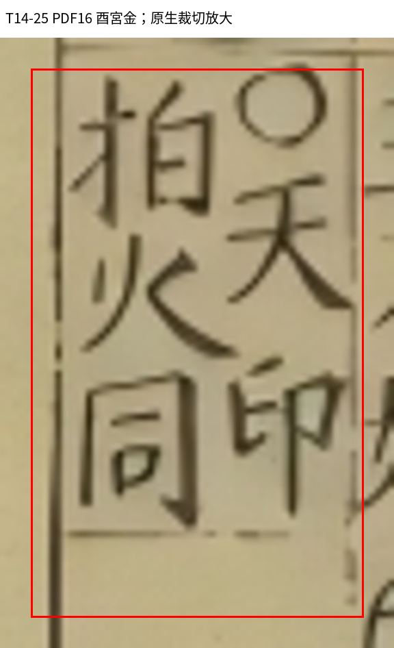

請看紅框內的字，是「相火同」還是「柏火同」？

### T14-26

卡片：酉宮水圖列（星平總會命海）.md；第16頁。現讀：絕根星；候選：絕祿星。
判斷：待看原圖／無法判斷。依據：候選各別審，不由其他工具結論或同詞重出定稿。
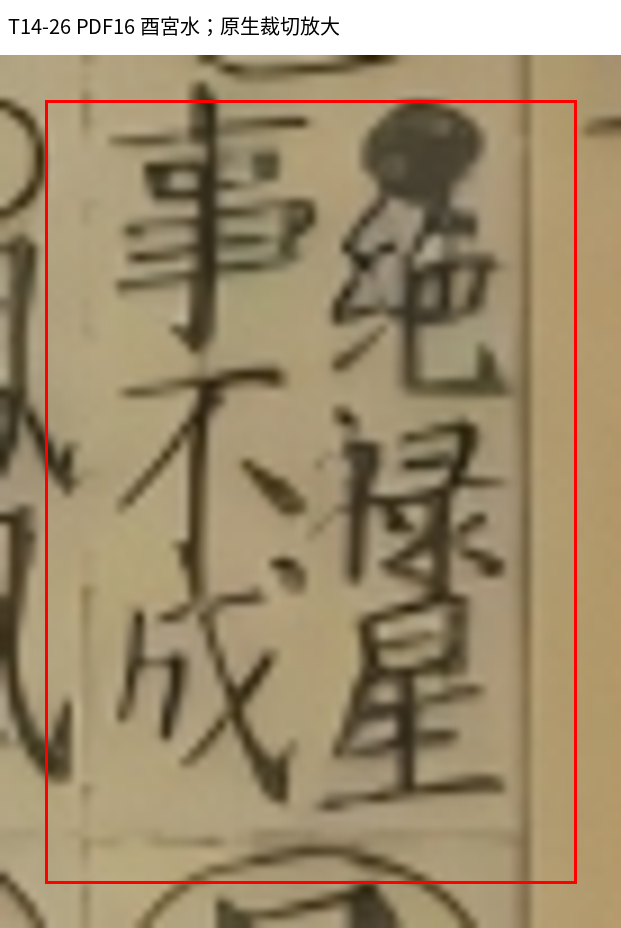

請看紅框內的字，是「絕根星」還是「絕祿星」？

### T14-27

卡片：酉宮孛圖列（星平總會命海）.md；第16頁。現讀：主喜怒；候選：喜怒。
判斷：待看原圖／無法判斷。依據：候選各別審，不由其他工具結論或同詞重出定稿。
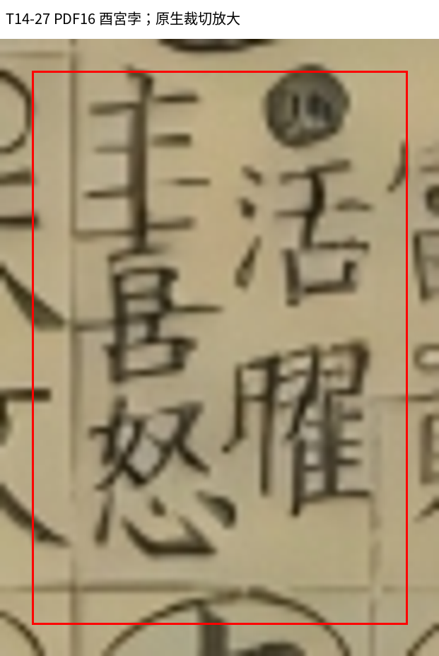

請看紅框內的字，是「主喜怒」還是「喜怒」？

## 三處淂字共同裁決

[部件與並排圖](命海16_淂字三處部件複核.md)。若確認為淂，保留原刻淂，通行字另記得，這一輪不覆寫。

## 需要使用者決定

1. T14-03是否採纛；仍逐筆確認，不因另一工具讀纛就接受。
2. T14-13、19、24是否同為淂；先判左旁，再判右半，不能只在得／淨兩字內強選。
3. 其餘每一格各別回答；異體項是否保留原字而不裁。天娼不得跨格全局改。
