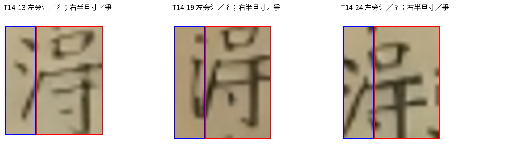
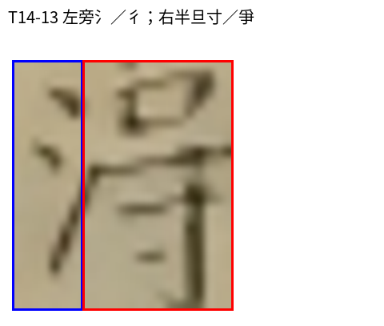
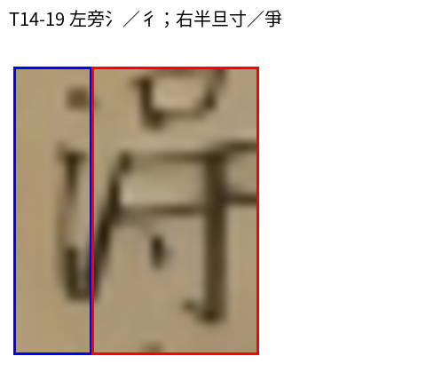
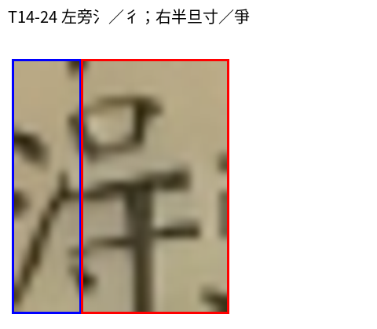

# 命海第16頁三處淂字部件複核

總數3處：子宮木、寅宮金、酉宮火。三者共同裁決，沒有以任何工具的讀值作答案。

## 目前可說與不能說

- 左旁：三處都有點狀起筆及左下挑的輪廓，較近氵；沒有看見足以確認彳的兩長撇加直豎結構。但細筆有糊損，不把缺筆自行補畫。
- 右半：三處上方有近方框，中部橫畫與下方豎鈎／點狀殘筆；較近旦加寸的結構，未清楚見到爭字上下折筆穿中豎的完整形。
- 其中框內橫畫及寸點並非每處都完整清楚；因此只能提出「較支持同為淂」，不能寫成已確定三處都是淂。
- 若使用者核定淂：保留原刻「不淂地」，另欄寫「通行字：得」。不能把淂直接覆寫為得或淨。

## 一題一圖

### T14-13-左旁

請看紅框及藍框內的左旁，是「三點水」還是「彳」？

### T14-13-右半

請看紅框內的右半，是「旦加寸」還是「爭」？

### T14-19-左旁

請看紅框及藍框內的左旁，是「三點水」還是「彳」？

### T14-19-右半

請看紅框內的右半，是「旦加寸」還是「爭」？

### T14-24-左旁

請看紅框及藍框內的左旁，是「三點水」還是「彳」？

### T14-24-右半

請看紅框內的右半，是「旦加寸」還是「爭」？

## 需要使用者決定

1. 左旁是否三處均為氵；若不同，請指出哪一處。
2. 右半是否三處均為旦寸；若不能確認，保持待看原圖，不作正確值。
