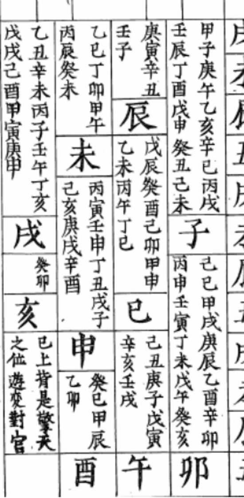

# 擎天傳世文獻與綱目對照

## 核對結果

使用者提供辰至亥8組40筆，非整張60筆。另有子、卯兩組各10筆。
本庫《張果星宗》PDF實際第40頁表圖、41頁解說可回查；本次只核這兩頁相關範圍。
原圖未宮作丙辰；使用者及公開轉錄作丙戌。原圖卯組作戊午；公開轉錄另有戌午。
按本庫第40頁原圖讀法列記為60筆、60個不同合法年字，無重複；此為文字完整性檢查，不是以計算補字。

## 原圖逐組字列（工作對照，未寫入卡片）

|原圖落字|年字列|
|---|---|
|子|甲子、庚午、乙亥、辛巳、丙戌、壬辰、丁酉、戊申、癸丑、己未|
|卯|己巳、甲戌、庚辰、乙酉、辛卯、丙申、壬寅、丁未、戊午、癸亥|
|辰|庚寅、辛丑、壬子|
|巳|戊辰、癸酉、己卯、甲申、乙未、丙午、丁巳|
|午|己丑、庚子、戊寅、辛亥、壬戌|
|未|乙巳、丁卯、甲午、丙辰、癸未|
|申|丙寅、壬申、丁丑、戊子、己亥、庚戌、辛酉|
|酉|癸巳、甲辰、乙卯|
|戌|乙丑、辛未、丙子、壬午、丁亥、戊戌、己酉、甲寅、庚申|
|亥|癸卯|

## 公開文獻位置與限制

- [古今圖書集成藝術典第568卷影像序37頁之轉錄](https://zh.wikisource.org/wiki/Page:Gujin_Tushu_Jicheng,_Volume_468_(1700-1725).djvu/37)：與使用者段落相符；頁面標尚未校對，丙戌重出、戌午保留為轉錄疑點。
- [張果星宗卷二公開轉錄](https://guolaoxing.com/archives/4813)：亦有相同字列及疑點；沒有將兩個轉錄網站當作兩份已獨立校勘的版本。
- 引用說明關於擎天屬火、遊奕屬水與對宮，於本庫張果PDF41頁亦可讀到；原段不代替綱目圖的實際字位。
- 本次未下載古今集成整卷原檔，外部頁碼是網站影像序號，不冒充PDF頁碼。

## 與綱目既有校讀逐筆比較

已比對58筆既有擎天校讀，文字相同14筆、不同44筆。不同只列候選，不宣稱哪書錯、也不改卡。完整清單見同名JSON。

|年字|綱目PDF頁|綱目既有校讀|張果40原圖|
|---|---|---|---|
|丁丑|75|卯|申|
|丁亥|95|子|戌|
|丁卯|79|卯|未|
|丁巳|83|丑|巳|
|丁未|87|巳|卯|
|丁酉|91|卯|子|
|丙午|85|丑|巳|
|丙寅|77|辰|申|
|丙戌|93|卯|子|
|丙申|89|巳|卯|
|丙辰|81|卯|未|
|乙丑|75|辰|戌|
|乙卯|79|卯|酉|
|乙巳|83|丑|未|
|壬午|86|辰|戌|
|壬戌|94|子|午|
|壬申|90|寅|申|
|己丑|75|寅|午|
|己亥|95|巳|申|
|己卯|79|丑|巳|
|己巳|83|巳|卯|
|己未|87|卯|子|
|己酉|91|子|戌|
|庚子|74|子|午|
|庚寅|78|子|辰|
|庚戌|94|辰|申|
|庚申|90|辰|戌|
|庚辰|82|巳|卯|
|戊午|85|巳|卯|
|戊子|73|辰|申|
|戊寅|77|寅|午|
|戊戌|93|子|戌|
|戊申|89|卯|子|
|戊辰|81|丑|巳|
|甲午|85|丑|未|
|甲寅|77|辰|戌|
|甲辰|81|卯|酉|
|癸卯|80|巳|亥|
|癸巳|84|卯|酉|
|辛亥|96|子|午|
|辛卯|80|巳|卯|
|辛巳|84|午|子|
|辛未|88|子|戌|
|辛酉|92|辰|申|

## 後續處理

這份對照可協助定位綱目101頁圈字，但尚未將每個圈字與所有干支逐項回圖驗收；原待核單不刪。先核未宮丙辰等關鍵字，再逐欄回綱目73–96頁；不同書與不同頁分別保留，不用外部文獻代填、不自行覆寫既有引文。
本次卡片異動0，未進入階段2。
