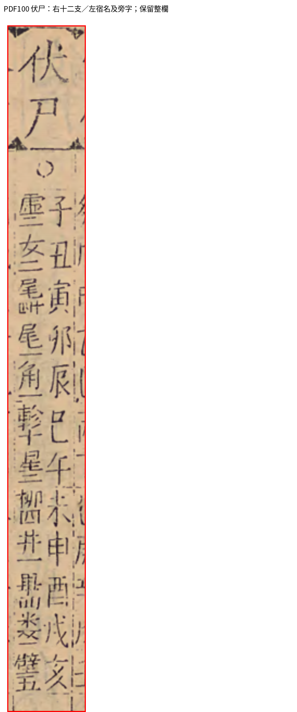
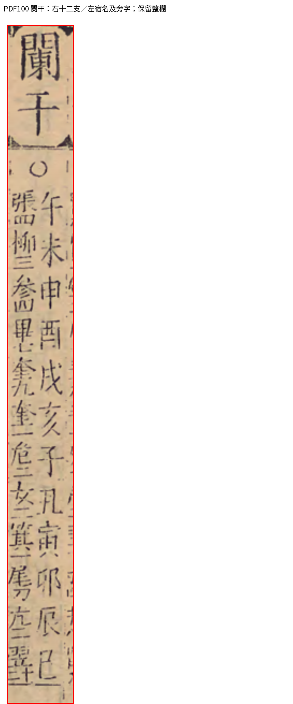

# 綱目100頁伏尸、闌干整欄對照

## 目錄

- [範圍與限制](#範圍與限制)
- [整欄原圖](#整欄原圖)
- [每格對照](#每格對照)
- [待看原圖與需要決定](#待看原圖與需要決定)

## 範圍與限制

24格：伏尸12格、闌干12格；卡片現收23格、1格未收。只對照，不改卡；不續核T22四格與貫索。來源類型人工校讀。
每筆圖仍保留整欄，紅框只指出當格，藍色H旁標指出原像素橫段位置（不畫在字上）。**橫段數不能直接當數字筆畫數**：可能混入宿名末筆或鄰筆，無法可靠分開就寫無法判斷。沒有把既收值當答案。
原PDF內嵌圖646×938像素；放大不增加真實細節。其他工具的讀值不參與原圖值判定。

## 整欄原圖

## 每格對照

|編號／支格|現卡已收|本輪暫讀|橫畫數／人工判斷|整欄紅框／問題|
|---|---|---|---|---|
|FS-01 子|虛二|虛二|機器檢出2段，是否均屬數字無法判斷；二／一，待看原圖|[原圖](../待裁決/原圖/綱目100整欄/FS-01.png)；請看紅框內的字，是「虛二」還是「虛一」？|
|FS-02 丑|女二|女二|機器檢出4段，是否均屬數字無法判斷；較支持二；待確認|[原圖](../待裁決/原圖/綱目100整欄/FS-02.png)；請看紅框內的字，是「女二」還是「女一」？|
|FS-03 寅|尾十四|尾十四|機器檢出3段，是否均屬數字無法判斷；較支持十四；待確認|[原圖](../待裁決/原圖/綱目100整欄/FS-03.png)；請看紅框內的字，是「尾十四」還是「尾四十」？|
|FS-04 卯|尾一|尾一|機器檢出2段，是否均屬數字無法判斷；一／宿字末筆，待看原圖|[原圖](../待裁決/原圖/綱目100整欄/FS-04.png)；請看紅框內的字，是「尾一」還是「尾二」？|
|FS-05 辰|角二|角二|機器檢出2段，是否均屬數字無法判斷；二／一，待看原圖|[原圖](../待裁決/原圖/綱目100整欄/FS-05.png)；請看紅框內的字，是「角二」還是「角一」？|
|FS-06 巳|軫十|軫十|機器檢出0段，是否均屬數字無法判斷；較支持十；待確認|[原圖](../待裁決/原圖/綱目100整欄/FS-06.png)；請看紅框內的字，是「軫十」還是「軫十一」？|
|FS-07 午|星三|星三|機器檢出1段，是否均屬數字無法判斷；較支持三；待確認|[原圖](../待裁決/原圖/綱目100整欄/FS-07.png)；請看紅框內的字，是「星三」還是「星二」？|
|FS-08 未|柳四|柳四|機器檢出2段，是否均屬數字無法判斷；較支持四；待確認|[原圖](../待裁決/原圖/綱目100整欄/FS-08.png)；請看紅框內的字，是「柳四」還是「柳一」？|
|FS-09 申|井二|井二|機器檢出2段，是否均屬數字無法判斷；二／一，待看原圖|[原圖](../待裁決/原圖/綱目100整欄/FS-09.png)；請看紅框內的字，是「井二」還是「井一」？|
|FS-10 酉|畢四|畢四|機器檢出0段，是否均屬數字無法判斷；較支持四；待確認|[原圖](../待裁決/原圖/綱目100整欄/FS-10.png)；請看紅框內的字，是「畢四」還是「畢一」？|
|FS-11 戌|婁一|婁一|機器檢出3段，是否均屬數字無法判斷；一／宿字末筆，待看原圖|[原圖](../待裁決/原圖/綱目100整欄/FS-11.png)；請看紅框內的字，是「婁一」還是「婁二」？|
|FS-12 亥|壁五|壁五|機器檢出0段，是否均屬數字無法判斷；較支持五；待確認|[原圖](../待裁決/原圖/綱目100整欄/FS-12.png)；請看紅框內的字，是「壁五」還是「壁三」？|
|LG-01 午|張四|張四|機器檢出0段，是否均屬數字無法判斷；較支持四；待確認|[原圖](../待裁決/原圖/綱目100整欄/LG-01.png)；請看紅框內的字，是「張四」還是「張一」？|
|LG-02 未|柳三|柳三|機器檢出1段，是否均屬數字無法判斷；較支持三；待確認|[原圖](../待裁決/原圖/綱目100整欄/LG-02.png)；請看紅框內的字，是「柳三」還是「柳二」？|
|LG-03 申|參四|參四|機器檢出1段，是否均屬數字無法判斷；較支持四；待確認|[原圖](../待裁決/原圖/綱目100整欄/LG-03.png)；請看紅框內的字，是「參四」還是「參一」？|
|LG-04 酉|畢七|畢七|機器檢出0段，是否均屬數字無法判斷；折筆仍待看原圖|[原圖](../待裁決/原圖/綱目100整欄/LG-04.png)；請看紅框內的字，是「畢七」還是「畢九」？|
|LG-05 戌|奎九|奎九|機器檢出0段，是否均屬數字無法判斷；折筆仍待看原圖|[原圖](../待裁決/原圖/綱目100整欄/LG-05.png)；請看紅框內的字，是「奎九」還是「奎七」？|
|LG-06 亥|室一|室一|機器檢出2段，是否均屬數字無法判斷；一／宿字末筆，待看原圖|[原圖](../待裁決/原圖/綱目100整欄/LG-06.png)；請看紅框內的字，是「室一」還是「室二」？|
|LG-07 子|危三|危三|機器檢出1段，是否均屬數字無法判斷；較支持三；待確認|[原圖](../待裁決/原圖/綱目100整欄/LG-07.png)；請看紅框內的字，是「危三」還是「危二」？|
|LG-08 丑|女二|女二|機器檢出0段，是否均屬數字無法判斷；二／一，待看原圖|[原圖](../待裁決/原圖/綱目100整欄/LG-08.png)；請看紅框內的字，是「女二」還是「女一」？|
|LG-09 寅|箕二|箕二|機器檢出3段，是否均屬數字無法判斷；二／一，待看原圖|[原圖](../待裁決/原圖/綱目100整欄/LG-09.png)；請看紅框內的字，是「箕二」還是「箕一」？|
|LG-10 卯|未收|尾旁未定|機器檢出0段，是否均屬數字無法判斷；未收；本輪依指示暫停T22，不續判|[原圖](../待裁決/原圖/綱目100整欄/LG-10.png)；此格未收，本輪暫停續核；請先確認整欄對照，暫不要求讀值。|
|LG-11 辰|亢二|亢二|機器檢出1段，是否均屬數字無法判斷；二／一，待看原圖|[原圖](../待裁決/原圖/綱目100整欄/LG-11.png)；請看紅框內的字，是「亢二」還是「亢一」？|
|LG-12 巳|翼十二|翼十二|機器檢出2段，是否均屬數字無法判斷；較支持十二；待確認|[原圖](../待裁決/原圖/綱目100整欄/LG-12.png)；請看紅框內的字，是「翼十二」還是「翼二十」？|

## 待看原圖與需要決定

1. 女二／女一須先分清女字末筆與旁數，不能只數看得到幾條橫線；兩處女二均未因此宣告已正確。
2. 柳四的框形輪廓較支持四，但仍須在整欄確認；不能因他工具讀一而覆寫。
3. 尾、婁、室旁的短橫是否屬數字一，或與宿字末筆黏連，仍待原圖裁決。
4. 請先確認這份整欄對照；未確認前T22四格、貫索續核保持暫停。
5. 藍色H標記只是定位輔助，不是人工筆畫定稿；不清楚者無法判斷。
