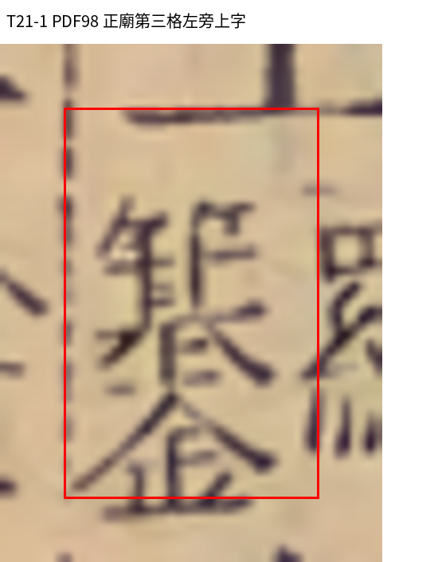
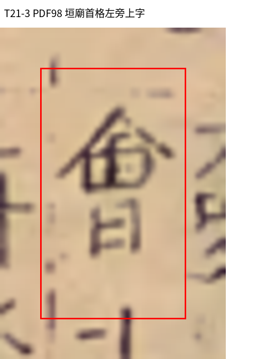

# 綱目98頁T21左旁三字本輪複核

總數3筆，均為人工校讀；只看字形，不以重出次數、其他書或工具答案定稿。通過後仍只記「左旁標記字，未定歸屬取法」。

## T21-1 正廟第三格左旁上字

上部可見兩組短斜筆，下部近其形；要確認竹頭是否屬此字，不能把下方金字併入。較支持箕，仍待裁。

請看紅框內的上字，是「箕」還是「其」？

## T21-2 正廟第十一格左旁上字

上部豎挑與下部短筆模糊，能否完整辨為此加糸尚不足；下方水字另列，不用重複出現作理由。無法判斷。

請看紅框內的上字，是「紫」還是「炁」？

## T21-3 垣廟首格左旁上字

可見覆蓋形上部與內部方框、橫畫，下部日形邊界仍小而糊；較支持會，不以其他格重出作證。

請看紅框內的上字，是「會」還是「合」？

## 需要使用者決定

1. 箕、紫、會逐字裁決，不整批接受。
2. 不能確認者保留未確認，不收錄取法，不改任何卡。

## 使用者本次回覆（2026-11-19）

以下為使用者後續讀值；前文保留本輪提報當時的候選與判斷，不能把舊候選當成最新結論。

|編號|使用者原話／讀值|目前狀態|範圍|
|---|---|---|---|
|T21-1|簊金（看不懂，但我覺得是這個組合）|候選，仍未確認；逐字保留簊，不改成箕|正廟第三格左旁組合；不把兩字合稱為已知術語|
|T21-2|婁水|使用者指定讀值；取代紫／炁舊候選|正廟第十一格左旁組合；不補對應關係|
|T21-3|會|使用者指定讀值|垣廟首格左旁上字；不擴大到其他旁字|

統計：收到3筆回覆，其中2筆明確讀值、1筆保留疑慮的候選。本次沒有新增、修改或刪除卡片。
三項均仍只作「左旁標記字，未定歸屬取法」；使用者讀字不等於已授權建立操作規則。
需要使用者決定的剩餘事項：T21-1簊金尚未定字，其餘兩項的字形回覆已記錄，不再重問紫／炁、會／合。

## 2026-11-20確認已落實入卡

T21-2婁水、T21-3會已分別新增位置字列卡；不補定義或取法，仍為左旁標記字、未定歸屬取法。上文未入卡為先前狀態，現以[補錄完整全文](../勘校修訂/2026-11-20已確認六卡補錄.json)為準。T21-1簊金仍是候選，不套用。
