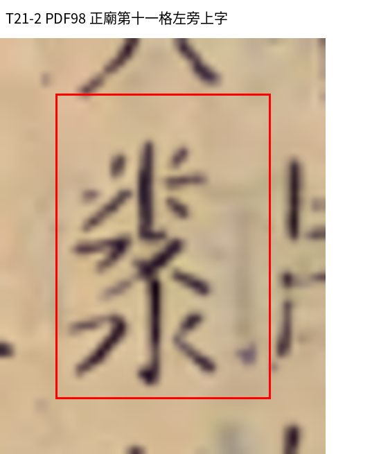

# 綱目98頁T21左旁三字本輪複核

總數3筆，均為人工校讀；只看字形，不以重出次數、其他書或工具答案定稿。通過後仍只記「左旁標記字，未定歸屬取法」。

## T21-1 正廟第三格左旁上字

上部可見兩組短斜筆，下部近其形；要確認竹頭是否屬此字，不能把下方金字併入。較支持箕，仍待裁。

請看紅框內的上字，是「箕」還是「其」？

## T21-2 正廟第十一格左旁上字

上部豎挑與下部短筆模糊，能否完整辨為此加糸尚不足；下方水字另列，不用重複出現作理由。無法判斷。

請看紅框內的上字，是「紫」還是「炁」？

## T21-3 垣廟首格左旁上字

可見覆蓋形上部與內部方框、橫畫，下部日形邊界仍小而糊；較支持會，不以其他格重出作證。

請看紅框內的上字，是「會」還是「合」？

## 需要使用者決定

1. 箕、紫、會逐字裁決，不整批接受。
2. 不能確認者保留未確認，不收錄取法，不改任何卡。
