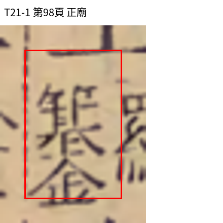
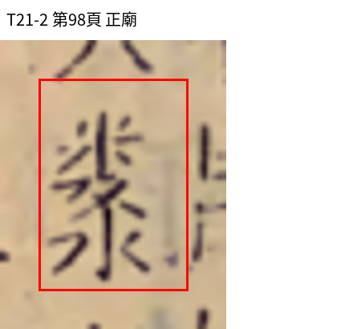
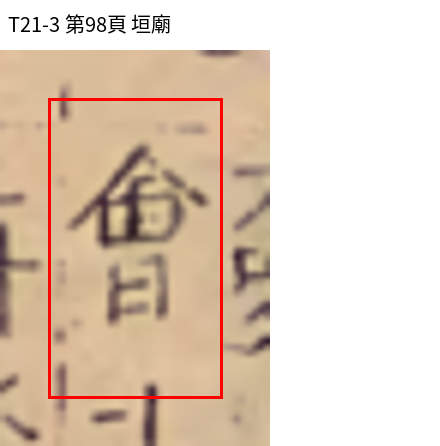

# 綱目98頁右列成果與左旁三字待核

本次新增3張右列字列卡，各12格，共36格。左旁字不因此算已提取，兩列的對應取法也未補造。既有卡片與先前待裁決修訂未動。

- [逐字核讀紀錄](../ocr/校讀/星學綱目正傳-098三欄右列字列.json)
- [格式與既有卡不變性檢查](綱目98右列字列驗證.json)

## 左旁字形待核

下面的字僅為候選，未入卡。原圖只裁切放大與加框，不重畫字形；每條只問一個字。

### T21-1

《星學綱目正傳》第98頁，正廟欄第三格左旁上字。
目前：尚未收錄此左旁字，不涉及覆寫；候選：箕。
差異：這個小字尚未核定，不能用右列或常見取法代填。

紅框上方的字可以讀作「箕」嗎？

### T21-2

《星學綱目正傳》第98頁，正廟欄第十一格左旁上字。
目前：尚未收錄此左旁字，不涉及覆寫；候選：紫。
差異：這個小字尚未核定，不能用右列或常見取法代填。

紅框上方的字可以讀作「紫」嗎？

### T21-3

《星學綱目正傳》第98頁，垣廟欄首格左旁上字。
目前：尚未收錄此左旁字，不涉及覆寫；候選：會。
差異：這個小字尚未核定，不能用右列或常見取法代填。

紅框上方的字可以讀作「會」嗎？

## 還沒完成的範圍

三欄左旁其他字、同列歸屬及97頁玉堂疑字仍待核；這三條不是全頁的完整問題清單。未核部分記入catalog與待辦，不建占位卡。
下一處續核：100頁宿名欄旁的小字與數字；不重做已確認的98頁右列。仍屬階段1.5，不宣布完成。
